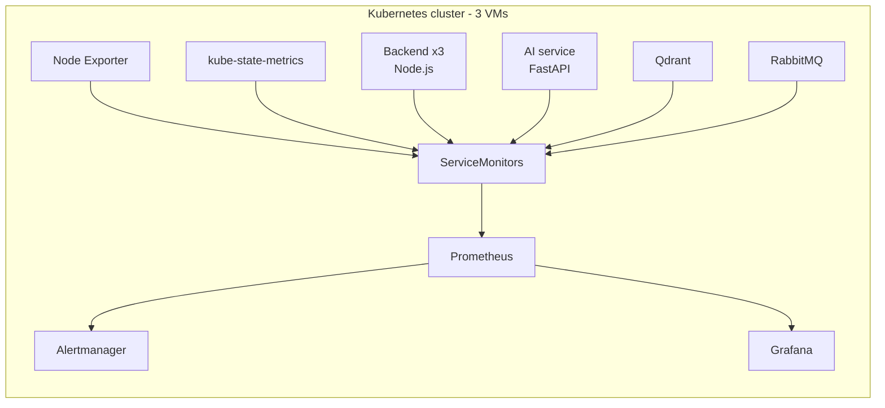

# Monitoring & Observability

Complete Prometheus and Grafana monitoring stack for the **Samsar** cloud-native application, running on a 3-node Kubernetes cluster built on virtual machines. It covers three layers: the VMs, the Kubernetes cluster, and the deployed application services.

---

## Table of Contents

1. [Overview](#overview)
2. [Architecture](#architecture)
3. [Cluster Setup](#cluster-setup)
4. [Monitoring Stack Deployment](#monitoring-stack-deployment)
5. [Grafana Dashboards](#grafana-dashboards)
   - [Dashboard 1 – Infrastructure (VM level)](#dashboard-1--infrastructure-vm-level)
   - [Dashboard 2 – Kubernetes Resources](#dashboard-2--kubernetes-resources)
   - [Dashboard 3 – Application Services](#dashboard-3--application-services)
6. [Application Instrumentation](#application-instrumentation)
   - [Node.js / Express Backend](#nodejs--express-backend)
   - [FastAPI AI Microservice](#fastapi-ai-microservice)
   - [Qdrant and RabbitMQ](#qdrant-and-rabbitmq)
7. [ServiceMonitor Configuration](#servicemonitor-configuration)
8. [Verification](#verification)
9. [Access](#access)
10. [Status and Roadmap](#status-and-roadmap)

---

## Overview

| Layer | What is monitored | Dashboard |
|---|---|---|
| Virtual machines | CPU, load, I/O wait, memory, swap, disk, network, uptime, processes | **Infrastructure** |
| Kubernetes cluster | Node readiness, pod states, restarts, requests vs allocatable, node pressure | **Kubernetes Resources** |
| Application | Backend, AI microservice, Qdrant, RabbitMQ | **Application Services** |

The stack is deployed with the `kube-prometheus-stack` Helm chart and includes:

- **Prometheus** – metrics collection and storage
- **Prometheus Operator** – manages Prometheus through CRDs (`ServiceMonitor`, `PrometheusRule`, ...)
- **Grafana** – dashboards and visualization
- **Alertmanager** – alert routing
- **Node Exporter** – VM-level metrics (DaemonSet on every node)
- **kube-state-metrics** – Kubernetes object state metrics

---

## Architecture

```
┌──────────────┐   /metrics   ┌────────────────┐   discovery   ┌────────────┐   queries   ┌─────────┐
│ Application  │ ───────────► │ ServiceMonitor │ ────────────► │ Prometheus │ ──────────► │ Grafana │
│ (pods)       │              │ (CRD)          │               │            │             │         │
└──────────────┘              └────────────────┘               └─────┬──────┘             └─────────┘
                                                                     │
                                                                     ▼
                                                              ┌──────────────┐
                                                              │ Alertmanager │
                                                              └──────────────┘
```

**Pipeline:** `Application → /metrics → Kubernetes ServiceMonitor → Prometheus → Grafana`

Infrastructure and cluster metrics follow the same path, using Node Exporter and kube-state-metrics as the exporters.



---

## Cluster Setup

- 3-node Kubernetes cluster built on VMs
- Metrics are collected cluster-wide, across all namespaces
- Node Exporter runs on every node to expose VM-level metrics

---

## Monitoring Stack Deployment

```bash
# Add the chart repository
helm repo add prometheus-community https://prometheus-community.github.io/helm-charts
helm repo update

# Create the namespace
kubectl create namespace monitoring

# Install the stack
helm install kube-prometheus-stack prometheus-community/kube-prometheus-stack \
  --namespace monitoring \
  --values values.yaml
```

Check the deployment:

```bash
kubectl get pods -n monitoring
```

Expected components: `prometheus`, `alertmanager`, `grafana`, `prometheus-operator`, `kube-state-metrics`, and one `node-exporter` pod per node.

> **Tip:** by default the Prometheus Operator only selects `ServiceMonitor` objects carrying the Helm release label (`release: kube-prometheus-stack`). Either add this label to your ServiceMonitors or set `serviceMonitorSelectorNilUsesHelmValues: false` in `values.yaml`.

---

## Grafana Dashboards

Three dashboards cover the system from bare metal up to the application.

### Dashboard 1 – Infrastructure (VM level)

Focus: health and performance of the virtual machines. Source: **Node Exporter**.

| Area | Panels |
|---|---|
| CPU | CPU utilization, load average, I/O wait |
| Memory | Memory usage, swap usage |
| Disk | Disk usage, disk I/O |
| Network | Traffic (in/out), network errors |
| System | Uptime, system processes |

### Dashboard 2 – Kubernetes Resources

Focus: cluster health, monitored cluster-wide across namespaces. Sources: **kube-state-metrics**, cAdvisor / kubelet.

| Area | Panels |
|---|---|
| Nodes | Node readiness, node pressure conditions (memory, disk, PID) |
| Pods | Pod states, pod restarts |
| Resources | CPU and memory usage |
| Capacity | Resource requests versus allocatable resources |

> **Status:** started. It provides the foundation for further pod-level, workload, and failure-state observability.

### Dashboard 3 – Application Services

Focus: the deployed Samsar application. It covers the **backend**, the **AI (FastAPI) microservice**, **Qdrant**, and **RabbitMQ**.

**Backend section**

| Area | Panels |
|---|---|
| Health | Backend pod health |
| Traffic | Request rate, active requests |
| Errors | HTTP error rate |
| Breakdown | Requests by pod, route, and status code |
| Latency | P50, P95, P99 request latency |
| Runtime | Node.js CPU and memory usage, heap utilization |
| Event loop | Event loop latency |
| GC | Garbage collection activity |
| Per pod | Resource and performance metrics per pod |

**AI microservice section** (FastAPI) – Python process metrics, garbage collection, and HTTP metrics as instrumentation completes.

**Qdrant section** – vector database health and performance.

**RabbitMQ section** – queue and broker health.

---

## Application Instrumentation

### Node.js / Express Backend

Instrumented with [`prom-client`](https://github.com/siimon/prom-client) and exposing a dedicated `/metrics` endpoint.

**HTTP metrics**

- Total requests
- Request rate
- HTTP status codes
- Active requests
- Request duration (histogram, used for P50/P95/P99)

**Node.js runtime metrics**

- CPU usage
- Resident memory
- Heap usage
- Event loop metrics
- Garbage collection metrics

Minimal example:

```js
const client = require('prom-client');
const register = new client.Registry();
client.collectDefaultMetrics({ register });

const httpRequestDuration = new client.Histogram({
  name: 'http_request_duration_seconds',
  help: 'HTTP request duration in seconds',
  labelNames: ['method', 'route', 'status_code'],
  buckets: [0.05, 0.1, 0.3, 0.5, 1, 2, 5],
  registers: [register],
});

app.get('/metrics', async (req, res) => {
  res.set('Content-Type', register.contentType);
  res.end(await register.metrics());
});
```

### FastAPI AI Microservice

Monitoring integration is **in progress**.

- Prometheus client instrumentation integrated
- Dedicated Prometheus metrics registry created
- `/metrics` endpoint exposed
- Python process, platform, and garbage-collection metrics enabled
- Preparing ServiceMonitor integration and Grafana visualization

Minimal example:

```python
from fastapi import FastAPI, Response
from prometheus_client import (
    CollectorRegistry, generate_latest, CONTENT_TYPE_LATEST,
    ProcessCollector, PlatformCollector, GCCollector,
)

registry = CollectorRegistry()
ProcessCollector(registry=registry)
PlatformCollector(registry=registry)
GCCollector(registry=registry)

app = FastAPI()

@app.get("/metrics")
def metrics():
    return Response(generate_latest(registry), media_type=CONTENT_TYPE_LATEST)
```

### Qdrant and RabbitMQ

Both are covered by the application dashboard.

- **Qdrant** exposes Prometheus metrics natively on `/metrics` (port `6333`).
- **RabbitMQ** exposes metrics through the `rabbitmq_prometheus` plugin (port `15692`).

Add a ServiceMonitor for each, following the pattern below.

---

## ServiceMonitor Configuration

A ServiceMonitor lets Prometheus automatically discover and scrape every replica behind a Service. Example for the backend:

```yaml
apiVersion: monitoring.coreos.com/v1
kind: ServiceMonitor
metadata:
  name: samsar-backend
  namespace: monitoring
  labels:
    release: kube-prometheus-stack
spec:
  namespaceSelector:
    matchNames:
      - samsar            # namespace where the app runs
  selector:
    matchLabels:
      app: samsar-backend
  endpoints:
    - port: http          # name of the Service port
      path: /metrics
      interval: 15s
```

Requirements:

- The Service must have a **named port** matching `endpoints[].port`.
- The Service labels must match `selector.matchLabels`.
- The ServiceMonitor labels must match the Prometheus selector (see the tip in [Monitoring Stack Deployment](#monitoring-stack-deployment)).

Use the same pattern for the FastAPI service, Qdrant, and RabbitMQ, adjusting labels, port names, and paths.

---

## Verification

**Check that targets are discovered**

```bash
kubectl port-forward -n monitoring svc/kube-prometheus-stack-prometheus 9090:9090
```

Open `http://localhost:9090/targets` and confirm the targets are `UP`. The backend job should list **three targets**, one per backend pod. This has been verified.

**Useful queries**

```promql
# Backend pods up
up{job="samsar-backend"}

# Request rate
sum(rate(http_requests_total[5m]))

# Error rate (5xx)
sum(rate(http_requests_total{status_code=~"5.."}[5m]))

# P95 latency
histogram_quantile(0.95, sum(rate(http_request_duration_seconds_bucket[5m])) by (le))
```

> Metric names depend on your instrumentation; adjust them to match what your `/metrics` endpoint exposes.

---

## Access

```bash
# Grafana
kubectl port-forward -n monitoring svc/kube-prometheus-stack-grafana 3000:80

# Prometheus
kubectl port-forward -n monitoring svc/kube-prometheus-stack-prometheus 9090:9090

# Alertmanager
kubectl port-forward -n monitoring svc/kube-prometheus-stack-alertmanager 9093:9093
```

Retrieve the Grafana admin password:

```bash
kubectl get secret -n monitoring kube-prometheus-stack-grafana \
  -o jsonpath="{.data.admin-password}" | base64 -d; echo
```

---
